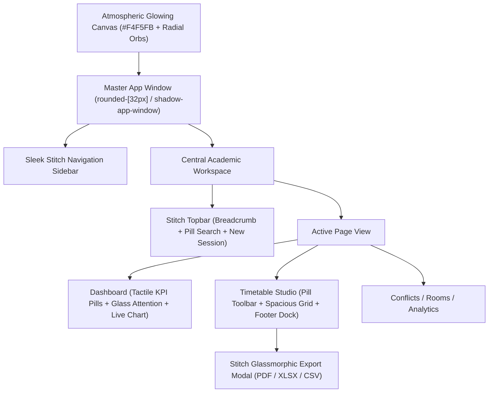

# Design Specification: Timora Google Stitch "Artisanal Academic Precision" Overhaul

- **Author**: Antigravity Principal Product Designer & Senior Frontend Engineer
- **Date**: 2026-10-15
- **Status**: Proposed (Awaiting Review)
- **Primary References**: 
  - Google Stitch Design Archive: `stitch_timora_academic_operations_platform_ui_ux.zip`
  - Stitch Design System: `DESIGN.md` (Artisanal Academic Precision)
  - Timetable Studio Reference: `timora_spacious_uncongested_timetable_studio`
  - Weekly Export Modal Reference: `timora_timetable_studio_with_weekly_export_pdf_excel_csv`

---

## 1. Overview & Vision

Timora's interface is being elevated from standard enterprise rectangular layouts into an artisanal, tactile, glassmorphic academic operations platform based on Google Stitch's "Artisanal Academic Precision" design system.

The design embodies:
1. **Atmospheric Canvas & Floating Glass Window**: A luminous, warm alabaster canvas (`#FAF9FD` / `#F4F5FB`) with soft organic background ambient glows, hosting a master floating application window (`rounded-[32px] lg:rounded-[38px]`, `border border-white/90`, `shadow-app-window`).
2. **Tactile Minimalism**: Pill-shaped segmented controls (`Week | Day | Month`), pill date navigators, pill search bars, and obsidian charcoal (`#121316`) primary buttons with micro-highlight edges.
3. **Spacious Uncongested Scheduling**: Generous card heights, airy typography, pastel-tinted harmonic subject cards (Mint, Indigo, Sky, Amber, Rose), current-day dark pill indicator (`15 • Tue`), and dashed empty slot targets with centered `+`.
4. **Stitch Weekly Export Dialog**: Floating glassmorphic modal with 3 multi-format selector cards (PDF, XLSX, CSV), appendix preference toggles, schema validation check, and instant download feedback.
5. **Operational Consistency**: Full preservation of Supabase PostgreSQL 17 integration, conflict engine, published timetable states, and weekly export engines.

---

## 2. Design Tokens & Visual Physics

### 2.1 Color Palette
- **Canvas Base**: `#F4F5FB` to `#FAF9FD` with dual ambient radial blurs:
  - Orb 1 (Top Left): `radial-gradient(circle, rgba(224, 231, 255, 0.7) 0%, rgba(244, 245, 251, 0) 70%)`
  - Orb 2 (Bottom Right): `radial-gradient(circle, rgba(254, 240, 230, 0.75) 0%, rgba(244, 245, 251, 0) 70%)`
- **Master Shell Window**: `#FFFFFF` with `border border-white/90` and `backdrop-blur-md`
- **Hairline Dividers**: `#EAEAE7` / `#E2E2DE` / `rgba(226, 232, 240, 0.7)`
- **Obsidian Dark Accents**: `#121316` / `#0F172A`
- **Jewel Accents & Session Tints**:
  - **Mint / Emerald**: Background `#E8F8F0`, Border `#D1F2E2`, Text `#065F46`, Dot `#10B981` (Mathematics, Linear Algebra)
  - **Indigo / Violet**: Background `#F0EEFF`, Border `#E1DEFF`, Text `#4338CA`, Dot `#5B4DF5` (Operating Systems, Core CS)
  - **Sky / Blue**: Background `#EBF5FF`, Border `#D6EBFF`, Text `#0369A1`, Dot `#0284C7` (Database Systems, Networks)
  - **Amber / Gold**: Background `#FEF8E7`, Border `#FDEFC9`, Text `#92400E`, Dot `#F59E0B` (Machine Learning, Practical Labs)
  - **Rose / Coral**: Background `#FEF2F2`, Border `#FEE2E2`, Text `#DC2626`, Dot `#EF4444` (Conflicts, Critical Attention)

### 2.2 Typography & OpenType
- **Font Family**: Plus Jakarta Sans (`font-sans`) with Inter fallback, tabular numerals (`tabular-nums font-feature-settings: "tnum" 1`) for times, dates, room codes, and metrics.
- **Tracking**: Headings with sculpted negative tracking (`-0.02em` to `-0.03em`); uppercase metadata labels with positive tracking (`+0.04em`).

### 2.3 Radii & Elevation
- **Master Shell**: `rounded-[32px]` on mobile/tablet, `rounded-[38px]` on desktop.
- **Interactive Controls**: `rounded-full` for segmented toggles, search inputs, filter pills, and action buttons.
- **Cards & Panels**: `rounded-2xl` (`16px`) to `rounded-3xl` (`24px`).
- **Shadow Physics**:
  - `shadow-app-window`: `0 25px 70px -15px rgba(30, 41, 59, 0.08), 0 0 2px rgba(0, 0, 0, 0.04)`
  - `shadow-card-soft`: `0 8px 24px -6px rgba(100, 116, 139, 0.06)`
  - `shadow-xs`: `0 1px 2px rgba(0, 0, 0, 0.04)`

---

## 3. Structural Component Architecture

### 3.1 App Shell & Master Floating Window (`src/components/layout/app-shell.tsx`)
- Container: Centers a max-width `1560px` floating card within the viewport with ambient padding (`p-3 lg:p-6`).
- Ambient background shapes (`bg-blob-1` and `bg-blob-2`) fixed behind the shell.
- Seamless responsive collapse on mobile/tablet while maintaining full-width usability.

### 3.2 Navigation Sidebar (`src/components/layout/sidebar.tsx`)
- Timora monogram icon container with clean minimal branding.
- Navigation links using Stitch's `rounded-2xl` pills, subtle active card background (`bg-white shadow-card-soft border border-slate-200/60 font-semibold text-slate-900`) with indicator dot.
- User profile dock at bottom: Avatar circle, user name, role/designation, and green active pulse indicator.

### 3.3 Topbar & Command Search (`src/components/layout/topbar.tsx`)
- Breadcrumbs: `Academic Operations > [Page Title]` with subtle chevron divider.
- Full pill search bar with search icon and keyboard hint `(⌘K)`.
- Primary obsidian action button (`+ New Session` / `Publish Timetable`).

### 3.4 Timetable Studio (`src/app/timetable/` & `src/components/timetable/`)
- **Studio Toolbar**:
  - Pill segmented view control: `Week | Day | Month` with active white floating pill.
  - Date navigator pill with chevron arrows: `14 – 20 October 2026`.
  - Pill cohort selector: `Cohort: 5th Sem (Sec-B)` with dropdown arrow.
  - Pill filter button: Filter toggle with badge count.
  - Stitch Export button: Opens the floating glassmorphic export dialog.
- **Spacious Timetable Grid**:
  - Time column: Large bold time (`08:30 – 10:00`), subtle duration label (`90 min`).
  - Column headers: Date + day name, with current day highlighted in an obsidian pill with emerald dot (`15 • Tue`).
  - Session cards: `rounded-2xl` with pastel background and matching border, bold subject name, room tag, instructor, and section pill.
  - Conflict cards: Coral/rose alert styling with inline "Auto-Resolve" link and chevron.
  - Empty slots: Dashed hairline borders with centered `+` button for 1-click scheduling.
- **Footer Status Dock**:
  - Allocated hours (`38 hrs / wk` with mint dot).
  - Practical labs (`12 hrs` with amber dot).
  - Attention required (`1 Session` with coral dot).
  - AI Constraint Engine status indicator.

### 3.5 Stitch Weekly Export Dialog (`src/components/timetable/export-dialog.tsx`)
- Backdrop: `fixed inset-0 z-50 bg-slate-900/30 backdrop-blur-sm flex items-center justify-center p-4`.
- Dialog Shell: `bg-white max-w-lg rounded-3xl shadow-app-window border border-slate-100 p-6`.
- 3 Format Selection Cards:
  1. **PDF Document**: Landscape & high-resolution print.
  2. **XLSX Excel Sheet**: Multi-sheet formatted faculty roster.
  3. **CSV Raw Data**: Direct ERP/SIS import.
- Appendices & Preferences:
  - Faculty Notes & Cabin Details (checkbox).
  - Room Allocation & Floor Map (checkbox).
  - Student Conflict Ledger (checkbox).
- Footer: Schema validation seal ("Verified with timetable schema v4.2") + animated download button calling the existing `timetable-export-service.ts`.

### 3.6 Dashboard & Sub-Pages Harmonization
- Elevate Dashboard (`/`), Conflicts (`/conflicts`), Rooms (`/rooms`), and Analytics (`/analytics`) with Stitch's `rounded-2xl` cards, soft background fills, pill segmented buttons, and refined typography.

---

## 4. Implementation Steps

1. **Step 1: Design Tokens & Typography**: Update `globals.css` with Plus Jakarta Sans imports, ambient glow blob CSS, `shadow-app-window`, and Stitch color variables.
2. **Step 2: App Shell & Floating Window**: Transform `app-shell.tsx` into the floating glassmorphic master container with ambient background glow blobs.
3. **Step 3: Sidebar & Topbar Stitch Alignment**: Implement rounded-2xl navigation items, active indicator dots, user profile footer, and pill search/actions.
4. **Step 4: Stitch Export Dialog**: Build `src/components/timetable/export-dialog.tsx` matching the exact Stitch design and wire it to `timetable-export-service.ts`.
5. **Step 5: Timetable Studio Grid & Toolbar**: Refactor `studio-toolbar.tsx` and `grid-view.tsx` to match Stitch's uncongested layout, pastel cards, active-day pill, and bottom status dock.
6. **Step 6: Dashboard & Sub-Page Polish**: Refine Dashboard KPI cards, Attention panel, Quick actions, and sub-pages to match Stitch's glassmorphism and minimalism.
7. **Step 7: Verification**: Run `tsc`, `npm test`, `npm run lint`, `npm run build`, and capture desktop and tablet browser screenshots for before/after comparison.

---

## 5. Non-Negotiable Invariants
- **Domain Logic**: Preserve Supabase PostgreSQL 17 client, authentication context, conflict algorithms, and weekly export generators.
- **Git Author**: Always use `nrrahulurs-cmyk <nrrahulurs@gmail.com>`.
- **Zero Errors**: Build must succeed cleanly with all 152 tests passing.
